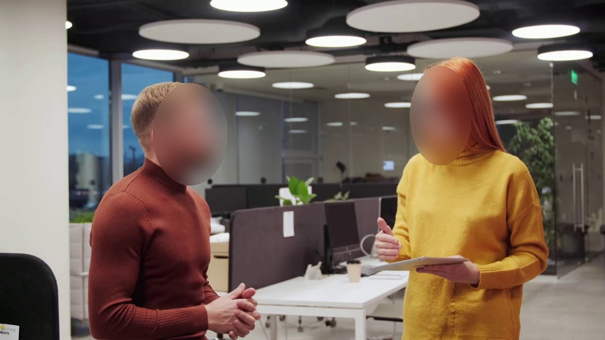

# Privacy-Preserving Video Anonymisation

Real-time face anonymisation for video on an ordinary laptop CPU: every face is **detected**, **tracked** across
frames and **blurred**. The evaluation measures what matters for privacy — **leaks** (faces left visible) — rather
than detection accuracy alone.

<table>
  <tr><th>Original</th><th>Anonymised (fast mode)</th></tr>
  <tr>
    <td></td>
    <td></td>
  </tr>
  <tr>
    <td></td>
    <td></td>
  </tr>
</table>

**Demo videos:** [street — side by side](web_assets/videos/A_side_by_side.mp4) ·
[office — side by side](web_assets/videos/C_side_by_side.mp4) ·
[street — anonymised](web_assets/videos/A_anonymised.mp4) ·
[office — anonymised](web_assets/videos/C_anonymised.mp4)

---

## Contents
1. [Highlights](#highlights)
2. [How it works](#how-it-works)
3. [Modes](#modes)
4. [Installation and usage](#installation-and-usage)
5. [Evaluation method](#evaluation-method)
6. [Results](#results)
7. [Engineering notes](#engineering-notes)
8. [Limitations and future work](#limitations-and-future-work)
9. [Reproducing the results](#reproducing-the-results)
10. [Project structure](#project-structure)
11. [Data, models and licences](#data-models-and-licences)

---

## Highlights

- **Real time on CPU:** ~24 ms per frame for detection + tracking + blur on 640×480 webcam video (~41 FPS),
  Intel Core i5-1235U, no GPU.
- **Privacy-focused metrics:** *coverage* and *leak rate* check whether the blurred area actually hides each face,
  pixel by pixel — not only whether a bounding box was found.
- **Three speed/privacy modes**, from real-time to maximum protection for recorded video.
- **Multi-scale detection** raises coverage of tiny faces (< 16 px) on WIDER FACE from 0.57 to 0.71.
- **0 leaks** on 1,800 hand-labelled face-frames of real street and office video, in all modes.

---

## How it works

```
 video frame ─► face detector ─► tracker ─► anonymiser ─► anonymised frame
                  YuNet            IoU +        ellipse,
                  1–2 scales       velocity     25% padding,
                  + NMS merge      prediction   blur / pixelate / solid
```

| Stage | What it does | Why |
|---|---|---|
| **Detector** | [YuNet](https://github.com/opencv/opencv_zoo/tree/main/models/face_detection_yunet) (0.23 MB ONNX) via OpenCV `FaceDetectorYN`. Frames are resized to the mode's scale(s) and padded to multiples of 32. | Very small and fast; runs in real time on CPU. |
| **Multi-scale merge** | In *max* mode the frame is processed at 640 px and 1600 px; results are merged with non-maximum suppression (IoU 0.4). | Upscaling brings tiny faces into YuNet's ~10–300 px working range; the 640 px pass keeps large faces inside it. |
| **Tracker** | Greedy IoU matching between predicted and detected boxes, constant-velocity motion model. A lost face keeps being blurred at its predicted position for up to 10 frames. | Detectors miss faces for a frame or two during head turns, motion blur or occlusion — each miss would be a privacy leak. |
| **Anonymiser** | Box padded by 25% on every side; elliptical mask; blur computed at 1/8 resolution and upscaled. Also *pixelate* and *solid*. | Padding absorbs imprecise boxes; the ellipse follows the face shape; low-resolution blur is strong and cheap. |

---

## Modes

| Mode | Scales | Score threshold | Typical use |
|---|---|---|---|
| `fast` | 640 px | 0.5 | Live video, real time |
| `balanced` | 1024 px | 0.3 | Near real time, more small faces |
| `max` | 640 + 1600 px | 0.3 | Recorded video, crowds, distant faces |

A lower score threshold trades extra blurred patches (false positives) for fewer missed faces — the right
trade-off for privacy, where a missed face is far worse than an unnecessary blur.

---

## Installation and usage

**Requirements:** Python 3.12, OpenCV ≥ 5.0.

```bash
git clone https://github.com/JamshedAli18/video-anonymizer.git
cd video-anonymizer
python -m venv .venv
.venv\Scripts\activate          # Windows  (Linux/macOS: source .venv/bin/activate)
pip install -r requirements.txt
```

**Webcam, live preview:**
```bash
python src/pipeline.py --source 0 --show
```

**Anonymise a video file:**
```bash
python src/pipeline.py --source input.mp4 --output output.mp4 --mode max --method blur
```

| Option | Values | Default |
|---|---|---|
| `--source` | `0` (webcam) or video path | `0` |
| `--output` | output `.mp4` path | none |
| `--mode` | `fast`, `balanced`, `max` | `fast` |
| `--method` | `blur`, `pixelate`, `solid` | `blur` |
| `--no-track` | disable tracking (comparison) | off |
| `--debug` | draw boxes: green = detected, orange = predicted by tracker | off |
| `--show` | live preview window | off |

---

## Evaluation method

Two complementary tests.

### 1. WIDER FACE validation — detector stress test
- **Data:** 3,226 images, 39,112 valid faces (faces flagged *invalid* in the annotations are excluded).
  39% of faces are smaller than 16 px — a deliberately hard benchmark.
- **Recall:** share of faces matched by a detection with IoU ≥ 0.5 (one-to-one greedy matching).
- **Coverage (privacy metric):** a face is *protected* if ≥ 90% of its box lies inside a single padded blur box.
- **False positives:** detections that overlap no labelled face (IoU < 0.3). This is an upper bound: some may be
  real faces that were not annotated.
- Results are reported per face-height bucket: < 16, 16–32, 32–64, 64–128, > 128 px.

### 2. Own video test set — leak test of the full pipeline
- **Clips:** 2 Pexels videos (street, office), trimmed to 12 s, 1280×720, ≤ 30 fps → 600 frames, 6 people,
  **1,800 face-frames**.
- **Labels:** hand-made in CVAT (track mode, exported as MOT 1.1), with a fixed protocol:
  - every face ≥ 40 px tall with any visible facial feature (frontal, profile, partly occluded);
  - tight boxes from forehead to chin and ear to ear; back of heads not labelled;
  - completeness checked with an audit script that lists face-sized detections without a label.
- **Leak:** a labelled face-frame where < 90% of the face ellipse is covered by the actually blurred ellipses
  (computed pixel-wise on masks).
- Also reported: share of people leaked at least once, **longest continuous leak** (seconds), false blurs per frame,
  and runtime. Each mode is run with tracking on and off.

---

## Results

All timings: Intel Core i5-1235U laptop, 8 GB RAM, CPU only, OpenCV 5.0.

### WIDER FACE — overall

| Configuration | Recall | Coverage | False pos. / image | ms / image |
|---|---|---|---|---|
| 640 px, thr 0.5 (**fast**) | 0.438 | 0.490 | 0.83 | 22.6 |
| 640 px, thr 0.3 | 0.490 | 0.599 | 3.88 | 16.6 |
| 1024 px, thr 0.5 | 0.602 | 0.659 | 1.21 | 46.3 |
| 1024 px, thr 0.3 (**balanced**) | 0.657 | 0.752 | 4.82 | 52.9 |
| 1600 px, thr 0.3 (ablation) | 0.738 | 0.814 | 5.34 | 136.9 |
| 640 + 1600 px, thr 0.3 (**max**) | **0.744** | **0.829** | 8.10 | 183.2 |

### WIDER FACE — coverage by face height

| Configuration | < 16 px | 16–32 | 32–64 | 64–128 | > 128 px |
|---|---|---|---|---|---|
| Faces in bucket | 15,266 | 11,184 | 7,553 | 3,191 | 1,918 |
| 1024 px, thr 0.3 | 0.570 | 0.819 | 0.895 | 0.924 | 0.953 |
| 1600 px, thr 0.3 | 0.701 | 0.861 | 0.900 | 0.924 | 0.923 |
| 640 + 1600 px, thr 0.3 | **0.714** | **0.873** | **0.912** | **0.943** | **0.968** |

### WIDER FACE — recall by face height

| Configuration | < 16 px | 16–32 | 32–64 | 64–128 | > 128 px |
|---|---|---|---|---|---|
| 640 px, thr 0.5 | 0.062 | 0.510 | 0.776 | 0.881 | 0.933 |
| 1024 px, thr 0.3 | 0.388 | 0.757 | 0.870 | 0.914 | 0.946 |
| 1600 px, thr 0.3 | 0.556 | 0.812 | 0.879 | 0.904 | 0.924 |
| 640 + 1600 px, thr 0.3 | 0.557 | 0.815 | 0.886 | 0.924 | 0.959 |

### Video leak test (1,800 face-frames)

| Clip | Mode | Tracking | Leak rate | People leaked | False blurs / frame | ms / frame* |
|---|---|---|---|---|---|---|
| Street (4 people) | fast | off / on | 0.00% / 0.00% | 0/4 | 0.00 / 0.00 | 12.9 / 12.6 |
| | balanced | off / on | 0.00% / 0.00% | 0/4 | 0.03 / 0.07 | 33.1 / 33.2 |
| | max | off / on | 0.00% / 0.00% | 0/4 | 0.06 / 0.22 | 108.8 / 149.8 |
| Office (2 people) | fast | off / on | 0.00% / 0.00% | 0/2 | 0.00 / 0.00 | 24.3 / 16.0 |
| | balanced | off / on | 0.00% / 0.00% | 0/2 | 0.09 / 0.15 | 33.5 / 34.8 |
| | max | off / on | 0.00% / 0.00% | 0/2 | 0.16 / 0.69 | 156.5 / 150.8 |

\* detection + tracking, 1280×720 frames. Differences of a few ms between runs are normal laptop timing noise.

### Key findings

1. **Small faces are the main challenge.** On WIDER FACE, the fast mode covers only ~49% of faces overall, mostly
   because 39% of faces are < 16 px.
2. **Upscaling helps tiny faces but hurts large ones.** 1600 px alone raises < 16 px coverage from 0.57 to 0.70,
   but drops > 128 px coverage from 0.953 to 0.923, as large faces exceed YuNet's range.
3. **Multi-scale fixes both ends:** 640 + 1600 px gives the best coverage in every size bucket (0.829 overall),
   at ~3.5× the cost of the 1024 px mode.
4. **Clear footage does not need the heavy modes.** With faces ≥ 40 px, all modes reach 0 leaks; the fast mode does
   it in real time with no false blurs, while heavier modes only add false blurs and runtime.
5. **Privacy vs false positives is a tunable trade-off:** lowering the threshold from 0.5 to 0.3 at 1024 px raises
   coverage from 0.659 to 0.752 while false positives rise from 1.2 to 4.8 per image.

---

## Engineering notes

- **Fast blur:** a full-resolution Gaussian blur with a kernel scaled to face size made the pipeline 2.5× slower
  (59.6 ms vs 24.3 ms per webcam frame). Blurring at 1/8 resolution and upscaling gives the same visual result
  at a fraction of the cost.
- **OpenCV 5:** the fixed-input YuNet model (`2023mar`) does not run on OpenCV 5's new inference engine; the
  dynamic-shape variant (`2026may`) is used, with inputs padded to multiples of 32.
- **Memory:** switching one detector between input sizes every frame caused out-of-memory errors on an 8 GB
  laptop; multi-scale mode keeps one detector instance per scale.
- **Exact privacy measurement:** coverage in the video test compares the real blurred ellipses with each face's
  ellipse pixel by pixel, instead of comparing rectangles.

---

## Limitations and future work

**Limitations**
- Faces < 16 px remain the main weakness: even max mode leaves ~29% of them uncovered on WIDER FACE.
- The video test set is small (2 clips, 6 people) and labelled by one annotator; faces < 40 px are not labelled
  in it.
- The detector never missed a face in the video test, so **the benefit of tracking is not yet quantified**.
- False-positive counts are upper bounds (unlabelled real faces may be counted).
- Faces only; licence plates and other identifiers are not handled.

**Future work**
- Controlled stress test (motion blur, low light, compression, downscaling) to measure where each mode fails and
  how much tracking reduces leaks.
- Moving-camera clips and crowded scenes in the video test set.
- Licence-plate anonymisation (e.g. trained on UFPR-ALPR).
- Comparison with a stronger detector (e.g. SCRFD) for a full accuracy–speed curve.

---

## Reproducing the results

**WIDER FACE** — download the validation images and `wider_face_split.zip` (official site or the
[Hugging Face mirror](https://huggingface.co/datasets/CUHK-CSE/wider_face)) into `data/widerface/`:
```bash
python src/eval_widerface.py                 # -> results/widerface_eval_multiscale.json
```

**Video test set**
```bash
python src/prep_videos.py                    # data/videos/raw/*.mp4 -> 12 s, 720p, <=30 fps clips
# label faces in CVAT (track mode), export "MOT 1.1" to data/videos/labels/<clip>.zip
python src/debug_labels.py A                 # label sizes vs detections on sample frames
python src/audit_labels.py A                 # lists face-sized detections without a label
python src/eval_video.py                     # -> results/video_eval.json
```

**Demo assets**
```bash
python src/make_assets.py                    # -> web_assets/ (H.264 videos, stills, results JSON)
```

---

## Project structure

```
video-anonymizer/
├── src/
│   ├── detect.py           # YuNet wrapper, multi-scale + NMS
│   ├── track.py            # IoU tracker with velocity prediction
│   ├── anonymize.py        # blur / pixelate / solid, ellipse mask, padding
│   ├── pipeline.py         # command-line tool
│   ├── eval_widerface.py   # WIDER FACE recall / coverage / false positives
│   ├── eval_video.py       # video leak test
│   ├── prep_videos.py      # trim / resize / frame-rate cap for test clips
│   ├── debug_labels.py     # label sanity check
│   ├── audit_labels.py     # label completeness check
│   ├── make_assets.py      # demo videos, stills, results data
│   └── demo_detect.py      # minimal detector demo
├── models/
│   └── face_detection_yunet_2026may.onnx
├── results/                # evaluation results (JSON)
├── web_assets/             # demo videos, before/after images, results data, credits
├── requirements.txt
└── LICENSE
```

---

## Data, models and licences

- **Code:** MIT — see [`LICENSE`](LICENSE).
- **YuNet model:** MIT, © Shiqi Yu. W. Wu, H. Peng, S. Yu, *YuNet: A Tiny Millisecond-level Face Detector*,
  Machine Intelligence Research, 20(5), 656–665, 2023.
- **WIDER FACE:** CC BY-NC-ND 4.0 — used for evaluation numbers only; no images are redistributed.
  S. Yang, P. Luo, C. C. Loy, X. Tang, *WIDER FACE: A Face Detection Benchmark*, CVPR 2016.
- **Demo and test clips:** [Pexels](https://www.pexels.com) (Pexels License) — source pages listed in
  [`web_assets/data/credits.json`](web_assets/data/credits.json).
- **Labelling tool:** [CVAT](https://www.cvat.ai).

---

## Author

**Jamshed** — [github.com/JamshedAli18](https://github.com/JamshedAli18)